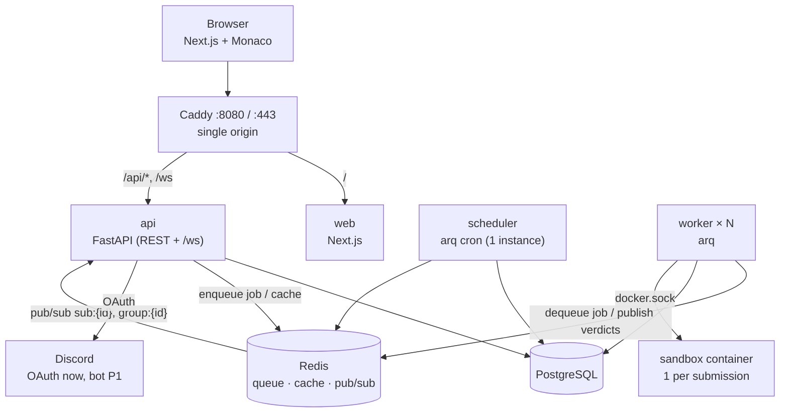

# Daily Commit — Architecture

Daily Commit is a group-based coding practice platform. Members solve a shared daily problem in an in-browser editor with real code execution, keep a group streak alive, and (P1) race each other, review each other's code, and run mock interviews.

Source documents: [`docs/Mohammad Project Proposal (1).pdf`](docs/) (PRD) and [`docs/Daily Commit System Map.html`](docs/) (system map). This file is the source of truth where they differ; see [Changes vs. the PRD / system map](#changes-vs-the-prd--system-map).

**Scope right now:** the P0 MVP for the midpoint demo (code execution, groups, daily problem, group streak, leaderboards), running on a laptop. Everything below is designed so P1 features and a VPS deployment slot in without rewrites.

**Built so far (P0 slices 0–3 and 6):** Python, Java and C++ in the sandbox; Discord OAuth plus dev login; per-group timezones (`DAY_TIMEZONE` is the default for new groups); LeetCode import with judge packs, so imported problems are solved and graded here. VPS deploy and the load test are still to come; see [§15](#15-build-status-and-slices).

---

## 1. System overview



| Service | Tech | Role |
|---|---|---|
| `caddy` | Caddy 2 | Single origin for web, API and WebSocket. Handles HTTPS in prod. |
| `web` | Next.js (App Router) + TypeScript + Tailwind + Monaco + TanStack Query | UI only. Never runs code. |
| `api` | FastAPI, Python 3.12 | REST + WebSocket. Auth, groups, problems, submissions, leaderboards. Never runs user code. |
| `worker` | arq (Python) | Pulls submission jobs, runs them in sandbox containers, streams verdicts. Scales horizontally. |
| `scheduler` | arq cron (Python) | Daily rollover: streak evaluation and next daily problem. Runs exactly one replica. |
| `postgres` | PostgreSQL 16 | Durable state. "If it's not in here, it didn't happen." |
| `redis` | Redis 7 | arq job queues, pub/sub for live updates, rate limits, and the leaderboard cache (the only cache). |
| sandbox | Docker, one image per language | Throwaway, locked-down container per submission. |

`api`, `worker` and `scheduler` are built from **one backend image** and differ only by command.

---

## 2. Decisions

| Area | Decision | Why |
|---|---|---|
| Auth | Discord OAuth (`identify` scope) handled by FastAPI, plus a dev-only "log in as seed user". | The pledge class is already on Discord, and the P1 bot needs Discord IDs anyway. We store no passwords. Dev login makes demos possible with no OAuth setup. |
| Identity model | `users` + `auth_identities(provider, provider_user_id)` | Adding GitHub or email login later is a new provider, not a migration. |
| Sessions | Opaque random token. Its SHA-256 is stored in `sessions`; the token itself is set as an `httpOnly`, `SameSite=Lax`, `Secure` (prod) cookie. | Revocable and simple. The same cookie authenticates the WebSocket handshake because everything is same-origin. |
| Sandbox | Our own Docker sandbox, one image per language, one container per submission | It's the PRD's core technical component. Judge0/Piston would outsource it, and Judge0 needs cgroup v1 + privileged mode (bad on WSL2). |
| Problem source | **LeetCode problems, solved and judged here.** Imported from LeetCode (study plans, difficulty/topic filters, or single URLs) with statement, difficulty and topics, each linked to its LeetCode page. A problem becomes solvable in our editor once it has a **judge pack** (`problems/leetcode/<slug>/`: signature, compare mode, limits, our tests, reference solutions in every language); only those are auto-picked. LeetCode problems without a pack (e.g. a leader's ad-hoc pick) are solved on leetcode.com: members link a LeetCode account (ownership proved by a code in their profile summary) and the scheduler credits their recent accepted submissions. That check also still credits packed problems solved on leetcode.com. Local `problems/` hold original content and are the fallback pool. | The goal is team LeetCode practice, and LeetCode's curated lists are what members want to work through, but members shouldn't have to leave the app. LeetCode's hidden tests aren't public, so a pack carries our own tests: samples from LeetCode's examples, hidden edge cases written by us. Statements are never committed (public repo); they come from the import. |
| Problem I/O (judged problems) | LeetCode-style function signatures, JSON test data, generated harness per language. Same format for local problems and judge packs. | Feels like real interview prep. A typed signature drives starter code and harness generation for all three languages. |
| Queue + jobs | `arq` (async, Redis-backed) for both the execution queue and cron | Same async model as FastAPI, little code. Workers and scheduler run as separate processes. |
| Worker language | Python | One backend language with shared models and DB code. Container start and compile time dominate latency, not the worker. Closes the PRD's "Go instead?" question. |
| Day boundary | Per-group IANA timezone, chosen at creation (default `DAY_TIMEZONE`, `America/New_York`) and fixed after that, since changing it would shift already-evaluated days. The day rolls at local midnight. The create form offers a short list of friendly names (Eastern (ET), Central (CT), Mountain (MT), Arizona, Pacific (PT), Alaska, Hawaii; `services/clock.FRIENDLY_ZONES`) but stores the real IANA zone, so daylight saving follows the zone. Groups show `timezone_label`: the friendly name, or the city for any other zone. Times on a group's pages (feed, leaderboard) are shown in the group's zone. | Works for any group, anywhere. Rollover is also the streak-evaluation moment and (P1) the solution-unlock moment. |
| Streak rule | Eligible members = joined before the day started **and** not `paused`. Streak +1 if every eligible member solved, else reset to 0. No eligible members → unchanged. | Faithful to "everyone keeps it alive," but a late joiner or an inactive member a leader paused can't kill it. |
| Groups | A user can be in many groups. Each group has its own daily problem. | Pledge class + clubs. One accepted solve counts for every group of that user whose today-problem matches. |
| Daily pick | Auto: least-recently-used problem for that group, rotating topics. A leader can override tomorrow's pick. | Zero maintenance by default, control when wanted. |
| Origin | Caddy fronts everything in dev **and** prod | Same-origin means no CORS and cookie-authenticated WebSockets, and dev matches prod. |
| Dev env | WSL2 (Ubuntu) + Docker Desktop. Repo lives inside the WSL filesystem. Everything runs via `docker compose`. | Fast file watching, and the worker drives sibling containers exactly as on the VPS. |
| Demo target | Laptop first. `compose.prod.yaml` + Caddy HTTPS make the VPS a documented step. | Keeps the domain, VPS and OAuth redirect off the critical path for the midpoint. |

### Changes vs. the PRD / system map

- **APScheduler inside FastAPI → arq cron in its own `scheduler` container.** In-process schedulers run every job once per API process, so they double-fire as soon as the API scales.
- **Caddy runs in dev too**, not just as the prod front door (same-origin cookies and WebSockets).
- **Data model additions** beyond the map's seven tables: `auth_identities`, `sessions`, `group_members`, `group_daily_problems`, `submission_results`, `group_day_solves`, `group_streak_days`. The map's `streaks` table is split into fields on `groups` + `group_streak_days` history.
- **Problems are authored as files in the repo** (`problems/`) and synced into Postgres, not edited in the DB.
- **"Run" vs "Submit"** distinction: Run executes sample tests only and never counts toward streaks.

---

## 3. Repository layout

```
web/                          Next.js app
  src/app/                    routes (App Router)
  src/lib/api/schema.ts       GENERATED from FastAPI OpenAPI — do not edit (make gen-api)
backend/                      one Python project (uv), several entrypoints
  pyproject.toml
  src/dailycommit/
    config.py                 pydantic-settings; all env vars live here
    db.py                     SQLAlchemy 2 async engine/session (asyncpg)
    models/                   ORM tables
    schemas/                  Pydantic request/response models
    domain/                   PURE logic, no I/O: streaks, daily_pick, leaderboard, timeutil,
                              activity, stats (P1: sm2, elo)
    services/                 DB/Redis operations shared by api, worker and scheduler:
                              clock (the day's timezone), daily, solves, rollover, leaderboard,
                              events, activity, history (past problems, my submissions/stats),
                              submissions, testcases
    api/
      main.py                 FastAPI app
      routers/                auth, groups, problems, submissions, leaderboards
      auth/                   discord oauth, dev login, session dependency
      ws.py                   WebSocket hub (Redis pub/sub → subscribed sockets)
    jobs/
      worker.py               arq WorkerSettings: run_submission
      scheduler.py            arq WorkerSettings with cron_jobs: rollover_groups
    sandbox/
      backend.py              SandboxBackend interface + DockerSandbox implementation
      runner.py               orchestrates compile/run, parses harness output
      compare.py              exact / unordered / float-tolerance comparison
      languages.py            registry of supported languages (image, harness, limits)
      codegen/                starter-code + harness templates per language
    problems/                 CLI: validate + sync problems/ → DB
    seed.py                   demo data
  alembic/                    migrations
  tests/
sandbox/images/
  python/Dockerfile           python:3.12-slim
  java/Dockerfile             eclipse-temurin:21-jdk + Gson jar
  cpp/Dockerfile              gcc + nlohmann/json header
problems/<slug>/              local (original) problems
  problem.yaml  statement.md  tests.json  solutions/ref.{py,java,cpp}
problems/leetcode/<slug>/     judge packs for imported LeetCode problems (no statement)
  judge.yaml  tests.json  solutions/ref.{py,java,cpp}
infra/
  compose.yaml                dev stack (hot reload)
  compose.prod.yaml           prod overrides
  Caddyfile
Makefile                      the only entrypoint for common tasks
docs/                         PRD + system map
```

---

## 4. Submission flow

Numbers match the system map.

1. **Submit.** The browser `POST /api/submissions {problem_id, language, code, kind}`. `kind` is `run` (sample tests only) or `submit` (all tests; only `submit` can count toward a streak). The API validates language and code size (64 KB) and applies a per-user rate limit (Redis).
2. **Save "pending".** Insert a `submissions` row with `status=queued`.
3. **Enqueue.** Enqueue the arq job `run_submission(submission_id)`. The browser subscribes to `submission:{id}` over `/ws`, **then** fetches the submission over REST. This order guarantees no result is missed.
4. **Grab next ticket.** A worker picks up the job, sets `status=running`, loads the code, the problem signature and the test inputs, and generates the harness for that language.
5. **Run.** The worker creates a sandbox container (see §5), streams in the code, harness and **inputs only** (a tar on the container's stdin), starts it, and streams stdout. A `submit` uses **two containers** (`runner.judge_submission`): the sample tests run alone first, with full details for the user. Only if they all pass do the hidden tests run, alone, in a second container that returns verdicts and times only. If a sample fails, the hidden tests are `skipped`. A `run` is the samples-only container.
6. **Output.** The harness compiles (Java/C++), prints `{"ready": true}`, then runs tests sequentially. After each test it prints one line to the original stdout, prefixed with a per-run marker: `{"i": 3, "out": <json>, "ms": 12, "err": null}`. The user's own stdout/stderr is redirected and captured (truncated) separately.
7. **Ring the bell.** The worker reads those lines in protocol order only (the first `ready`, then `i` = 0, 1, 2, …; anything else is ignored). It times each test with **its own clock**, as the gap since the previous accepted line. It compares `out` to the expected output **it holds** (exact / unordered / float tolerance per problem), then publishes the per-test verdict on Redis channel `submission:{id}` (channel name = WebSocket topic name).
8. **Bell heard.** Each API process runs one Redis pub/sub listener that fans messages out to its sockets subscribed to that topic.
9. **Pushed live.** The browser renders test-by-test results.
10. **Save final verdict.** The worker writes `submission_results` and the final `verdict`, `passed/total`, and `runtime_ms`, with the submission row locked (`services/submissions.finalize_submission`). For an accepted `submit`, it also inserts `group_day_solves` for every group of that user whose today-problem (in the group's timezone) is this problem, invalidates leaderboard caches, and publishes to `group:{id}`.

**Verdicts:** `AC` accepted, `WA` wrong answer, `TLE` time limit, `MLE` memory limit (see §5), `RE` runtime error, `CE` compile error, `IE` internal error (our fault).

On TLE/MLE/RE the container is killed. The current test gets that verdict and the remaining tests are marked `skipped`.

**Retries and recovery.** A job gets at most two tries (`max_tries = 2`):
- **Internal error on the first try** (e.g. a Docker failure): the job is retried after 2 s.
- **Worker crash:** arq runs the job again once its in-progress key expires, about `job_timeout` + 10 s = 190 s later.
- **Anything still unjudged:** a job lost from Redis, a failed enqueue, a job timeout, or a second failure. Every minute the scheduler marks any submission still `queued`/`running` 10 minutes (`SUBMISSION_STALE_AFTER_S`) after creation as `IE` and publishes its `final` event. Nothing stays pending forever.

IE is *provisional*. A submission is final once it's `done` with a real verdict, and a later job that gets one replaces an IE:
- The final write locks the row, so the first real result wins and any later attempt is discarded (no write, no credit, no events).
- A solve is credited only by that winning write, and `group_day_solves` is unique per (group, day, user).
- The sweep only ever touches `queued`/`running` rows.
- The editor keeps listening after an IE `final` (and polls every 10 s while it shows IE), so it ends on the real verdict.

---

## 5. Sandbox security model

The API never runs user code. The worker is trusted code that only *orchestrates* containers. It talks to the Docker daemon through the mounted `/var/run/docker.sock`, which is root-equivalent on the host, so the worker must never `exec`/`eval` anything from a submission itself.

Per submission, one container:

| Control | Setting |
|---|---|
| Network | `--network none` |
| Privileges | `--cap-drop ALL`, `--security-opt no-new-privileges`, `--user 65534:65534` |
| Filesystem | `--read-only` root; `--tmpfs /work:rw,exec,size=64m` for code and build output |
| Memory | `--memory=<limit>` with `--memory-swap` equal (no swap) |
| CPU | `--cpus 1` |
| Processes | `--pids-limit 64` (fork bombs) |
| Files / output | `ulimit nofile`, `fsize`. The worker stops reading after 1 MB of stdout. |
| Time | Per-test limit from `problem.yaml`, measured by the **worker's clock**: the gap between a test's result line and the previous accepted line, minus 250 ms of slack for serialization and Docker's log relay (`TIMING_SLACK_MS`). The time the program reports can only make the result stricter. A watchdog kills the container after the limit + 0.5 s without an accepted line, and at the overall deadline (Σ test budgets + start-up/compile budget, Java/C++ 10 s). |
| Lifetime | Removed after the run (`remove=True` plus a reaper for orphans on worker start) |
| Secrets | No env vars or mounts from the host. Expected outputs never enter the container. |
| Memory verdict | MLE if the kernel OOM-killed the container, if the harness exits 137 on an allocation failure (`MemoryError` / `OutOfMemoryError` / `bad_alloc`), or if the run timed out while at its memory limit. For the last case, a sampler thread reads one-shot `docker stats` (0.5 s client timeout) while a test has been silent for over half its budget. The watchdog uses the latest reading (≥ 90% of the limit in use, ignoring reclaimable page cache) and never waits for Docker. No fresh reading means TLE. |

**Forgery resistance:** user code shares a process with the harness, so it can read the run's marker and print lines that look like the harness's. It gains nothing:
- **Correctness:** outputs are compared in the worker, against expected values the container never sees.
- **Time:** lines count only in protocol order and are timed by the worker. A forged `ready`, a duplicate, or a result out of order buys no time, and a forged `ms` can't lower a test's time.
- **Information:** a container that holds hidden-test inputs never returns anything the program controls (stdout, return values, error text, compiler output), so hidden inputs can't be printed back to the browser.

What remains:
- **Verdicts and times:** per-test verdicts and times of hidden tests are still visible, a few bits per submission (and submissions are rate-limited).
- **Work across tests:** all tests of a run share one process, so a solution can overlap work across tests (e.g. a background thread). The run's overall deadline still caps it. A fresh process per test would close this; it isn't built.

**Threats the adversarial suite must contain** (per language): infinite loop, fork bomb, memory bomb, network access attempt, disk fill, huge stdout, reading env/filesystem for secrets, writing outside `/work`, sleeping past the deadline, killing the harness.

**Hardening path:** `SandboxBackend` is an interface, and `DockerSandbox` takes a `runtime` setting. On the VPS, set `SANDBOX_RUNTIME=runsc` (gVisor) for kernel-level isolation. Docker Desktop doesn't support gVisor, so dev uses `runc`.

**Throughput path:** v1 does a cold container per submission (~0.3–1 s overhead). If load tests demand it, add a pool of pre-created idle containers per language. That's a change inside `DockerSandbox` only.

---

## 6. Problem format

Each problem is a folder in `problems/` and is synced into Postgres by `make sync-problems`.

```yaml
# problems/two-sum/problem.yaml
slug: two-sum
title: Two Sum
difficulty: easy            # easy | medium | hard
topics: [arrays, hashing]
function: twoSum
params:
  - { name: nums, type: "int[]" }
  - { name: target, type: int }
returns: "int[]"
compare: unordered          # exact | unordered | { float: 1e-6 }
limits: { time_ms: 2000, memory_mb: 256 }
```

`tests.json`:

```json
[
  { "input": { "nums": [2, 7, 11, 15], "target": 9 }, "expected": [0, 1], "sample": true },
  { "input": { "nums": [3, 3], "target": 6 }, "expected": [0, 1], "sample": false }
]
```

- **Types (v1):** `int`, `long`, `double`, `bool`, `string`, and 1-D (`[]`) / 2-D (`[][]`) arrays of each. `ListNode` and `TreeNode` are reserved names for later (serialized as LeetCode-style level-order arrays).
- **Type mapping:** `int[]` → `list[int]` / `int[]` / `vector<int>`; `long` → `int` / `long` / `long long`; `string[]` → `list[str]` / `String[]` / `vector<string>`; and so on. The mapping lives in `sandbox/codegen/` and is used both for starter code and for the harness.
- **Harness:** generated per language from the signature. It reads the inputs JSON, deserializes the typed args, calls the user function inside a try/catch, serializes the return value, and times each call. Java uses Gson and C++ uses nlohmann/json; both are baked into the images.
- **Validation:** `sync-problems` checks the schema and type-checks every test against the signature. It also **runs each `solutions/ref.*` through the real sandbox** and fails if any reference solution doesn't get AC, which verifies the hand-written expected outputs. This applies to local problems and judge packs alike.
- **Upsert:** by `slug`, with `content_hash` to skip unchanged problems. Removing a problem from the repo marks it `retired` rather than deleting it (submissions reference it).
- **Exposure:** the API sends the statement, sample tests and starter code. Hidden tests' inputs and expected outputs are never returned by the API. Hidden inputs do enter the sandbox (the program needs them), but only in a container whose program-controlled output is never shown (§4 step 5, §5). Expected outputs never leave the worker.
- **Content:** the daily pool is imported LeetCode problems that have a judge pack (below). Local problems are for original content and are the fallback when no packed LeetCode problem exists.

### LeetCode problems

`python -m dailycommit.leetcode import` (`make import-leetcode`) reads LeetCode's public GraphQL API (unofficial; all calls live in `leetcode/client.py`) and upserts `problems` rows with `source='leetcode'`: title, number, difficulty, topic tags, `source_url`, and the statement HTML **sanitized once on import** (`nh3`), so the browser renders it directly. Paid-only questions are skipped. The importer never touches the judge fields (`signature`, `compare`, `limits`, `judge_hash`), so re-importing keeps a problem judgeable. A leader can set tomorrow's problem to any LeetCode URL; it's imported on the spot.

### Judge packs

A judge pack makes an imported LeetCode problem judgeable in our sandbox:

```
problems/leetcode/two-sum/
  judge.yaml        slug, function, params, returns, compare, limits (same fields as problem.yaml)
  tests.json        samples = LeetCode's examples; hidden tests = our own edge cases
  solutions/ref.py  ref.java  ref.cpp   (all three required)
```

- **No statement in the repo.** Title, difficulty, topics and statement come from the imported row; a `statement.md` in a pack fails validation. Hidden tests are written by us, never copied from LeetCode.
- **Validation** is the same as for local problems, plus: every language has a reference solution, the folder matches the slug, and no local problem uses the slug. Every reference must AC in the real sandbox before a pack loads; `sync --no-verify` skips packs entirely.
- **Sync** (`make sync-problems`) attaches each pack to its `source='leetcode'` row (importing it first if it's missing, which needs LeetCode to be reachable). It sets `signature`/`compare`/`limits`/`judge_hash` and replaces `test_cases` when `judge_hash` (over `judge.yaml`, `tests.json` and the solutions) changed. A pack removed from the repo detaches: its row loses the judge fields and tests and goes back to LeetCode-only (not retired).
- **Judgeable** means `signature IS NOT NULL` (`Problem.judgeable`, exposed as `judgeable` in the API). Judgeable problems get the normal editor workspace and accept submissions whatever their `source`; for the rest, `POST /submissions` returns 400 and the UI shows the LeetCode flow.

**Daily pick:** only from non-retired, judgeable problems (`domain.daily_pick.daily_pool`): packed LeetCode problems when any exist, otherwise local ones. A problem without a judge pack is never auto-picked; leaders can still assign one by hand.

**Solving on leetcode.com and verification** (problems without a pack, and as a second way to credit packed ones). A member links a LeetCode username, gets a code (`dailycommit-xxxxxx`), puts it in their LeetCode profile Summary, and we verify it there (`matchedUser.profile.aboutMe`), so nobody can claim someone else's solves. Every scheduler tick, before the rollover, `services/leetcode_solves.py` finds members who still owe a LeetCode problem on an unevaluated day and reads their `recentAcSubmissionList` (last 20 accepts, public). Matches go through the same `record_solves` as our judge, with `external_ref` set to the LeetCode submission id instead of `submission_id`. "Check now" (`POST /me/leetcode/check`, 15 s cooldown) does the same on demand. `record_solves` never credits a day the rollover already evaluated, so a late-seen accept can't contradict a recorded streak outcome.

---

## 7. Data model

P0 tables. All timestamps are `timestamptz` in UTC; `day` columns are the group-local calendar date.

| Table | Key columns |
|---|---|
| `users` | id, display_name, avatar_url, created_at |
| `auth_identities` | id, user_id, provider (`discord`, `dev`), provider_user_id, unique(provider, provider_user_id) |
| `sessions` | id, user_id, token_hash (unique), created_at, expires_at |
| `groups` | id, name, invite_code (unique), timezone, current_streak, best_streak, last_rolled_day, created_by, created_at |
| `group_members` | group_id, user_id, role (`leader` / `member`), joined_at, paused; PK(group_id, user_id) |
| `problems` | id, slug (unique), title, difficulty, topics (text[]), source (`local` / `leetcode`), source_url, frontend_id, statement_md, statement_html (LeetCode, sanitized), signature (jsonb), compare (jsonb), limits (jsonb), content_hash, judge_hash (LeetCode judge pack), retired. Judge fields are NULL when not judgeable here. |
| `test_cases` | id, problem_id, ordinal, is_sample, input (jsonb), expected (jsonb) |
| `group_daily_problems` | group_id, day, problem_id, assigned_by (`auto` / user_id); unique(group_id, day) |
| `submissions` | id, user_id, problem_id, group_id (the group it was made from; NULL for old rows, migration 0005), language, kind (`run` = samples only / `submit` = every test, can credit today / `practice` = every test, never credited), code, status (`queued` / `running` / `done`), verdict, passed, total, runtime_ms, created_at, finished_at |
| `submission_results` | submission_id, ordinal, verdict, time_ms, stdout_excerpt, actual (sample tests only) |
| `group_day_solves` | group_id, day, user_id, submission_id, solved_at; unique(group_id, day, user_id) |
| `group_streak_days` | group_id, day, eligible_count, solved_count, kept; unique(group_id, day) |

**Planned for P1:** `ratings` (user_id, elo), `matches` + `match_players`, `review_schedules` (SM-2 state per user/problem: ease, interval, repetitions, due_at), `comments` (on submissions), `interview_sessions`, `discord_guilds` (group ↔ guild/channel).

All schema changes go through Alembic migrations.

---

## 8. Scheduling semantics

**`rollover_groups`** runs every 5 minutes (arq cron) in the single `scheduler` process. It is idempotent: running it twice, or late, is safe.

For each group where the group-local date is past `last_rolled_day`, for each day *d* from `last_rolled_day` up to yesterday (local):

1. **Evaluate streak** for *d* with the pure function `domain.streaks.evaluate_day(members, solves, day_start)`:
   - eligible = members with `joined_at < start of d (local)` and not `paused`
   - if eligible is empty → streak unchanged
   - if every eligible member is in `group_day_solves` for *d* → `current_streak += 1`, update `best_streak`
   - else → `current_streak = 0`
   - write a `group_streak_days` row (unique constraint makes re-runs no-ops)
2. **(P1 hook)** unlock solutions for *d*, post the Discord summary.
3. **Ensure today's problem.** If no `group_daily_problems` row exists for today, pick with `domain.daily_pick` (from the judgeable pool, least-recently-used for this group, avoiding yesterday's topic) and insert it.
4. Advance `last_rolled_day`, all in one transaction per group.

Creating a group assigns today's problem immediately. A leader override for tomorrow is just a pre-inserted `group_daily_problems` row, which step 3 respects.

**"Solved today"** means an `AC` `submit` (or, for LeetCode problems, an Accepted LeetCode submission) whose time, converted to the group's timezone, falls on that group's day *d*, for that day's problem, and *d* hasn't been evaluated yet. All local-day math goes through `domain/timeutil.py` (zoneinfo), which is unit-tested for DST transitions.

**Leaderboards** (`domain.leaderboard`):
- **Daily:** today's solvers, earliest `solved_at` first; the page shows each solve time ("3:14 PM") in the group's timezone.
- **Weekly** (Mon–Sun, group-local): number of daily problems solved ("5 days"), tie-broken by total solve time after each day's start (whoever solved earlier in their days). The page says so in the card's hint.

Leaderboards are cached in Redis under `lb:{group}:{period}:{day}` (5-minute TTL) and invalidated on each solve. Nothing else is cached; today's problem is read from Postgres.

**`recover_submissions`** runs every minute in the same `scheduler` process: it marks stale `queued`/`running` submissions as `IE` (see §4, retries and recovery). Idempotent, like the rollover.

**P1 reminder job:** an evening cron warns about members who haven't solved yet (via the Discord bot). Stubbed in P0.

---

## 9. API

All under `/api`. JSON in and out. Auth via the session cookie; `401` when it's missing or invalid.

| Method & path | Purpose |
|---|---|
| `GET /auth/discord/login` | Redirect to Discord (sets `state` cookie for CSRF) |
| `GET /auth/discord/callback` | Check `state`, exchange code, upsert user + identity, create session, redirect to the `next` path from login (same-site paths only; default `/groups`). Failures redirect to `/login?error=…` |
| `GET /auth/providers` | Which sign-in options are enabled: `{discord, dev}` |
| `GET /auth/dev/users`, `POST /auth/dev/login {name}` | **ENV=dev only** (routes not registered otherwise); list dev users / log in as any name (creates the user on first use) |
| `POST /auth/logout` | Delete session |
| `GET /me` | Current user + groups |
| `POST /groups {name, timezone?}` | Create group (creator = leader); unknown IANA zone → 422 |
| `GET /groups/timezones` | The friendly zones offered for a new group (`{id: IANA zone, label}`) + the default (Eastern). Creating a group still accepts any valid IANA zone. |
| `POST /groups/join {invite_code}` | Join |
| `GET /groups` | My groups |
| `GET /groups/{id}` | Dashboard: today's problem, streak, members with solved-today status |
| `PATCH /groups/{id}/members/{user_id} {paused}` | Leader: pause/unpause |
| `PUT /groups/{id}/daily/{day} {problem_id}` | Leader: override a future day's problem |
| `POST /groups/{id}/invite/rotate` | Leader: new invite code |
| `GET /groups/{id}/leaderboard?period=day\|week` | Leaderboard |
| `GET /groups/{id}/history` | Past problems: every assigned day up to today, newest first, with the problem, whether you solved it, and solved/member counts (the day's eligible count once evaluated). Future days (a leader's pick for tomorrow) are never listed. Members only. |
| `GET /groups/{id}/history/{day}` | One of those days (404 for future days or days without a problem), for the practice page |
| `GET /groups/{id}/activity?limit=20` | Activity feed history: the group's most recent solves and joins from the DB, newest first (`limit` 1–50). Each entry has the same `id` as its live event. |
| `GET /problems/{slug}` | Statement, samples, starter code per language (only for problems assigned to one of your groups, or any in dev) |
| `POST /submissions` | Create a `run` / `submit` / `practice` (judgeable problems only: local, or LeetCode with a judge pack; otherwise 400). Optional `group_id`: the group it's made from; you must be a member (404 otherwise). Only a `submit` can credit a streak. |
| `GET/PUT/DELETE /me/leetcode`, `POST /me/leetcode/verify` | Link a LeetCode account: PUT `{username}` returns a code; verify once it's in the profile Summary |
| `POST /me/leetcode/check` | Credit today's LeetCode accepts now (15 s cooldown) |
| `GET /submissions/{id}` | Status, verdict, per-test results, the submitted code, problem title and group. Owner only: anyone else's is 404. |
| `GET /me/submissions?limit=&before_id=` | Your own submissions, newest first, paged by id (`next_before_id`). Scoped to the caller; there's no way to list someone else's. |
| `GET /me/stats` | Problems solved (distinct, AC submit or practice), Accepted rate (AC ÷ judged submit+practice, excluding samples-only runs and IE), streak per group, solves by language and difficulty (`domain/stats.py`) |
| `GET /health` | Liveness for compose/Caddy |

**WebSocket `/ws`** (cookie-authenticated on the handshake):

```jsonc
// client → server
{ "op": "subscribe",   "topic": "submission:42" }
{ "op": "unsubscribe", "topic": "submission:42" }
// server → client
{ "topic": "submission:42", "event": "test",  "data": { "i": 3, "verdict": "AC", "ms": 12 } }
{ "topic": "submission:42", "event": "final", "data": { "verdict": "WA", "passed": 7, "total": 10 } }
{ "topic": "group:7",       "event": "solve", "data": { "id": "solve:2026-11-05:5", "user_id": 5, "display_name": "…", "problem": "two-sum", "at": "…" } }
{ "topic": "group:7",       "event": "join",  "data": { "id": "join:5", "user_id": 5, "display_name": "…", "at": "…" } }
```

**Activity ids** (`domain/activity.py`) name the underlying row, not the message: `solve:{day}:{user_id}` (one solve per group, day and user) and `join:{user_id}` (one membership per group and user). The group page loads `GET /groups/{id}/activity` and puts live events on top, deduplicating by id. An event that arrives both in the history and over the socket (e.g. during page load) shows once, and a refresh keeps the history.

The server checks authorization on subscribe: the submission's owner, or a member of the group. Topic names are the Redis channel names (`submission:{id}`, `group:{id}`; P1: `match:{id}`, `interview:{id}`).

The OpenAPI schema is the contract. `make gen-api` regenerates `web/src/lib/api/schema.ts`.

---

## 10. Frontend (P0)

| Route | Content |
|---|---|
| `/login` | "Log in with Discord"; in dev, also a seed-user picker |
| `/groups` | My groups; create; join by code |
| `/join/[code]` | Invite link landing → join → redirect to group |
| `/g/[groupId]` | Dashboard: streak, today's problem card, member checklist, daily/weekly leaderboard, activity feed (history from `GET /groups/{id}/activity`, then live via `group:{id}`, merged by event id) |
| `/g/[groupId]/history` | Past problems: date, title, difficulty, tags, "✓ you", and how many members solved each day |
| `/g/[groupId]/history/[day]` | A past problem in the same Monaco workspace, in practice mode: Submit sends `kind: "practice"`, which never changes a streak or a day's results |
| `/me` | My history and stats: stats cards, then my submissions (newest first, "Load more"); linked from the header |
| `/me/submissions/[id]` | One of my submissions: the code (read-only Monaco), verdict and per-test results |
| `/g/[groupId]/today` | Problem page: statement + samples, Monaco editor, language switcher (code kept per language in localStorage), Run / Submit, live per-test results panel |

Data fetching uses TanStack Query with the generated types. A small `useTopic(topic)` hook wraps the single shared WebSocket connection.

---

## 11. P1 extension points

| Feature | Where it plugs in |
|---|---|
| Live 1v1 VS mode + ELO | `matches` tables; `domain/elo.py` (pure, unit-tested); matchmaking by rating within a group; `match:{id}` topic carries opponent progress (tests passed), driven by the same per-test verdict events |
| Spaced repetition (SM-2) | `review_schedules`; `domain/sm2.py`; quality score derived from attempts/verdicts/time; a "Reviews due" list on the dashboard |
| Mock interview mode | `interview_sessions`; shared editor via the `interview:{id}` topic (start with last-writer-wins text sync, upgrade to Yjs if needed); rubric stored as JSON |
| Peer solution review | Rollover step 2 flips the group-day to "unlocked"; `comments` table; review page lists group members' AC submissions for that day |
| Group weakness analytics | Aggregation queries over `submissions` × `problems.topics` per group (leader-only view). Drop it if the chapter's assessment tool already covers this. |
| Discord bot | New `bot` container (discord.py) from the same backend image. It consumes `group:{id}` events and scheduler hooks; users map via `auth_identities(provider='discord')`. |
| AI hints (P2) | API endpoint calling the Claude API with statement + user code, never the reference solution; rate-limited per user/day |

---

## 12. Local development (Windows)

One-time setup:

1. **WSL2:** in an *admin* PowerShell run `wsl --install -d Ubuntu`, reboot, and create your Linux user.
2. **Docker Desktop:** install it. In Settings → General, enable "Use the WSL 2 based engine". In Settings → Resources → WSL Integration, enable Ubuntu.
3. **Optional: cap WSL resources.** In `%UserProfile%\.wslconfig`:
   ```ini
   [wsl2]
   memory=8GB
   processors=4
   ```
4. **Clone inside WSL** (not under `/mnt/c`):
   ```bash
   sudo apt update && sudo apt install -y make git
   mkdir -p ~/dev && cd ~/dev && git clone <repo-url> DailyCommit && cd DailyCommit
   code .   # VS Code opens via Remote-WSL
   ```
5. `cp .env.example .env`. Discord credentials are optional because dev login works without them.

Daily loop:

```bash
make demo             # first run: everything below in order
make sandbox-images   # build the sandbox images (first time + when images change)
make up               # docker compose up: caddy, web, api, worker, scheduler, postgres, redis
make migrate          # alembic upgrade head
make sync-problems    # load problems/ into the DB (validates with reference solutions)
make seed             # demo users, a group, some history
# open http://localhost:8080
```

`make help` lists every target.

The dev compose bind-mounts source for hot reload (`uvicorn --reload`, `next dev`, and `watchfiles` restarting the arq processes; `arq --watch` is not used because it restarts in-process and keeps stale imports).

**Discord OAuth in dev:** create an application at discord.com/developers, add the redirect `http://localhost:8080/api/auth/discord/callback`, and put `DISCORD_CLIENT_ID` / `DISCORD_CLIENT_SECRET` in `.env`. The redirect is built from `PUBLIC_URL` (default `http://localhost:8080`). Without both credentials the Discord routes aren't registered and `GET /auth/providers` reports `discord: false`, so the login page shows dev login only. Discord's access token is used once to read the profile and never stored; name and avatar refresh on every login.

---

## 13. Deployment path (VPS)

- One VPS (4 GB+ RAM) with Docker installed.
- `docker compose -f infra/compose.yaml -f infra/compose.prod.yaml up -d`. The prod override removes bind mounts and reload, uses built images, gives Caddy the domain (automatic HTTPS), sets `ENV=prod` (disables dev login) and `Secure` cookies, and optionally sets `SANDBOX_RUNTIME=runsc`.
- Postgres data on a named volume, with a nightly `pg_dump` cron.
- Add the prod Discord redirect URI.
- Scale workers: `--scale worker=N`.

---

## 14. Testing strategy

| Layer | What |
|---|---|
| `domain/` unit tests | Streak evaluation edge cases (late joiner, paused, empty group, missed day), multi-day catch-up, DST transitions in `timeutil`, daily pick rotation, leaderboard ordering, activity feed merge/dedupe. P1: SM-2 and ELO. |
| Web unit tests | `node --test` (Node 22 runs TypeScript directly, no extra deps) for pure frontend logic such as `web/src/lib/feed.ts`; part of `make test`. |
| Runner protocol | Without Docker: protocol order and worker-measured time with a fake clock, opaque runs, the memory check, two-phase judging (`test_runner_protocol.py`). |
| Integration (Postgres) | `test_submission_recovery.py` rebuilds a throwaway `<db>_test` database with the migrations and judges real submissions: a late AC after the sweep wins, a retry after the sweep runs, two racing jobs record one result and one solve, a real result is never replaced. Skipped when no Postgres is reachable. Planned: API tests (auth/session, group join, authorization, problem exposure). |
| Sandbox suite (`-m sandbox`) | Needs Docker. Adversarial programs per language (§5 threats) must yield TLE/MLE/RE and leave no containers behind; AC/WA/CE fixtures per language. Hardening (`test_sandbox_hardening.py`, Python/Java/C++): forged timing is still TLE; hidden inputs never leak through output, exceptions, return values or compiler/import errors; memory bombs are MLE (5 runs each) while loops holding memory stay TLE; a failing or hanging stats call falls back to TLE without delaying the kill. |
| Problem validation | `make validate-problems` / `make sync-problems` run every reference solution (local problems and judge packs) in every provided language in the real sandbox; the sandbox suite also checks every pack's references. Unit tests cover pack loading/validation and the Python references without Docker. |
| Later | k6 or Locust load test (queue throughput, p50/p95 verdict latency, for the PRD's performance metric); Playwright smoke test of the submit flow |

---

## 15. Build status and slices

**Slice 0: P0 core (built).** Compose stack with Caddy, Alembic baseline, dev login, problem format + loader + five problems, Python sandbox + harness + runner, submissions end to end (REST → arq → sandbox → pub/sub → WS → editor UI), groups + invite codes, daily problem, rollover job, streaks, leaderboards, `make seed`, README demo script.

Each later slice is independent and should land as its own change:

| Slice | Work | Touch points |
|---|---|---|
| 1. Java + C++ (**built**) | Images (temurin 21 + Gson, gcc + nlohmann/json), harness/starter codegen, compile step inside the container, `ref.java` / `ref.cpp` for every problem | `sandbox/codegen/`, `sandbox/languages.py`, `sandbox/images/`, Makefile `sandbox-images` |
| 2. Discord OAuth (**built**) | `/auth/discord/login` + `/callback` (state cookie), `discord` identities, avatar, login button | `api/auth/`, `config.py`, login page |
| 3. Per-group timezone (**built**) | `groups.timezone` column + migration 0002, `GET /groups/timezones`, timezone picker on create, per-group day in `record_solves` | `services/clock.py` (`group_tz`), `services/solves.py` |
| 4. VPS deploy | `compose.prod.yaml`, Caddy domain + HTTPS, production web build, backups, `SANDBOX_RUNTIME=runsc` | `infra/` |
| 5. Load test | k6/Locust: queue throughput, p50/p95 verdict latency | new `loadtest/` |
| 6. Judge packs (**built**) | Judge imported LeetCode problems here: `problems/leetcode/<slug>/` packs (pilot: two-sum, valid-parentheses, merge-intervals), migration 0004 (`judge_hash`), judgeable-only daily pool, editor workspace for packed LeetCode problems | `problems/loader.py`, `problems/__main__.py`, `domain/daily_pick.py`, `services/daily.py`, today page |

P1 features follow in PRD priority order, at the extension points in §11.

---

## 16. Open questions

- Does the chapter's assessment tool already offer analytics? If so, drop group weakness analytics (P1).
- Checkpoint dates for CP2–CP4 (to confirm with the VP of Tech and Prof Development).
- Code-size, rate-limit and default resource limits: the values above are initial guesses, to tune after the load test.
