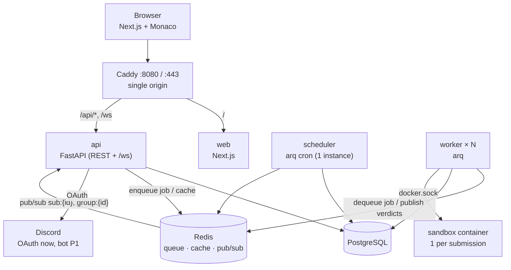

# Daily Commit — Architecture

Daily Commit is a group-based coding practice platform. Members solve a shared daily problem in an in-browser editor with real code execution, keep a group streak alive, and (P1) race each other, review each other's code, and run mock interviews.

Source documents: [`docs/Mohammad Project Proposal (1).pdf`](docs/) (PRD) and [`docs/Daily Commit System Map.html`](docs/) (system map). This file is the source of truth where they differ; see [Changes vs. the PRD / system map](#changes-vs-the-prd--system-map).

**Scope right now:** the P0 MVP for the midpoint demo (code execution, groups, daily problem, group streak, leaderboards), running on a laptop. Everything below is designed so P1 features and a VPS deployment slot in without rewrites.

---

## 1. System overview



| Service | Tech | Role |
|---|---|---|
| `caddy` | Caddy 2 | Single origin for web, API and WebSocket. Handles HTTPS in prod. |
| `web` | Next.js (App Router) + TypeScript + Tailwind + Monaco + TanStack Query | UI only. Never runs code. |
| `api` | FastAPI, Python 3.12 | REST + WebSocket. Auth, groups, problems, submissions, leaderboards. Never runs user code. |
| `worker` | arq (Python) | Pulls submission jobs, runs them in sandbox containers, streams verdicts. Scales horizontally. |
| `scheduler` | arq cron (Python) | Daily rollover: streak evaluation and next daily problem. Runs exactly one replica. |
| `postgres` | PostgreSQL 16 | Durable state. "If it's not in here, it didn't happen." |
| `redis` | Redis 7 | arq job queue, cache (leaderboards, today's problem), pub/sub for live updates. |
| sandbox | Docker, one image per language | Throwaway, locked-down container per submission. |

`api`, `worker` and `scheduler` are built from **one backend image** and differ only by command.

---

## 2. Decisions

| Area | Decision | Why |
|---|---|---|
| Auth | Discord OAuth (`identify` scope) handled by FastAPI, plus a dev-only "log in as seed user". | The pledge class is already on Discord, and the P1 bot needs Discord IDs anyway. We store no passwords. Dev login makes demos possible with no OAuth setup. |
| Identity model | `users` + `auth_identities(provider, provider_user_id)` | Adding GitHub or email login later is a new provider, not a migration. |
| Sessions | Opaque random token. Its SHA-256 is stored in `sessions`; the token itself is set as an `httpOnly`, `SameSite=Lax`, `Secure` (prod) cookie. | Revocable and simple. The same cookie authenticates the WebSocket handshake because everything is same-origin. |
| Sandbox | Our own Docker sandbox, one image per language, one container per submission | It's the PRD's core technical component. Judge0/Piston would outsource it, and Judge0 needs cgroup v1 + privileged mode (bad on WSL2). |
| Problem I/O | LeetCode-style function signatures, JSON test data, generated harness per language | Feels like real interview prep. A typed signature drives starter code and harness generation for all three languages. |
| Queue + jobs | `arq` (async, Redis-backed) for both the execution queue and cron | Same async model as FastAPI, little code. Workers and scheduler run as separate processes. |
| Worker language | Python | One backend language with shared models and DB code. Container start and compile time dominate latency, not the worker. Closes the PRD's "Go instead?" question. |
| Day boundary | Per-group IANA timezone (default `America/New_York`). The day rolls at local midnight. | Works for any group, anywhere. Rollover is also the streak-evaluation moment and (P1) the solution-unlock moment. |
| Streak rule | Eligible members = joined before the day started **and** not `paused`. Streak +1 if every eligible member solved, else reset to 0. No eligible members → unchanged. | Faithful to "everyone keeps it alive," but a late joiner or an inactive member a leader paused can't kill it. |
| Groups | A user can be in many groups. Each group has its own daily problem. | Pledge class + clubs. One accepted solve counts for every group of that user whose today-problem matches. |
| Daily pick | Auto: least-recently-used problem for that group, rotating topics. A leader can override tomorrow's pick. | Zero maintenance by default, control when wanted. |
| Origin | Caddy fronts everything in dev **and** prod | Same-origin means no CORS and cookie-authenticated WebSockets, and dev matches prod. |
| Dev env | WSL2 (Ubuntu) + Docker Desktop. Repo lives inside the WSL filesystem. Everything runs via `docker compose`. | Fast file watching, and the worker drives sibling containers exactly as on the VPS. |
| Demo target | Laptop first. `compose.prod.yaml` + Caddy HTTPS make the VPS a documented step. | Keeps the domain, VPS and OAuth redirect off the critical path for the midpoint. |

### Changes vs. the PRD / system map

- **APScheduler inside FastAPI → arq cron in its own `scheduler` container.** In-process schedulers run every job once per API process, so they double-fire as soon as the API scales.
- **Caddy runs in dev too**, not just as the prod front door (same-origin cookies and WebSockets).
- **Data model additions** beyond the map's seven tables: `auth_identities`, `sessions`, `group_members`, `group_daily_problems`, `submission_results`, `group_day_solves`, `group_streak_days`. The map's `streaks` table is split into fields on `groups` + `group_streak_days` history.
- **Problems are authored as files in the repo** (`problems/`) and synced into Postgres, not edited in the DB.
- **"Run" vs "Submit"** distinction: Run executes sample tests only and never counts toward streaks.

---

## 3. Repository layout

```
web/                          Next.js app
  src/app/                    routes (App Router)
  src/lib/api/schema.ts       GENERATED from FastAPI OpenAPI — do not edit (make gen-api)
backend/                      one Python project (uv), several entrypoints
  pyproject.toml
  src/dailycommit/
    config.py                 pydantic-settings; all env vars live here
    db.py                     SQLAlchemy 2 async engine/session (asyncpg)
    models/                   ORM tables
    schemas/                  Pydantic request/response models
    domain/                   PURE logic, no I/O: streaks, daily_pick, leaderboard, timeutil
                              (P1: sm2, elo)
    api/
      main.py                 FastAPI app
      routers/                auth, groups, problems, submissions, leaderboards
      auth/                   discord oauth, dev login, session dependency
      ws.py                   WebSocket hub (Redis pub/sub → subscribed sockets)
    jobs/
      worker.py               arq WorkerSettings: run_submission
      scheduler.py            arq WorkerSettings with cron_jobs: rollover_groups
    sandbox/
      backend.py              SandboxBackend interface + DockerSandbox implementation
      runner.py               orchestrates compile/run, parses harness output
      compare.py              exact / unordered / float-tolerance comparison
      codegen/                starter-code + harness templates per language
    problems/                 CLI: validate + sync problems/ → DB
    seed.py                   demo data
  alembic/                    migrations
  tests/
sandbox/images/
  python/Dockerfile           python:3.12-slim
  java/Dockerfile             eclipse-temurin:21-jdk + Gson jar
  cpp/Dockerfile              gcc + nlohmann/json header
problems/<slug>/
  problem.yaml  statement.md  tests.json  solutions/ref.{py,java,cpp}
infra/
  compose.yaml                dev stack (hot reload)
  compose.prod.yaml           prod overrides
  Caddyfile
Makefile                      the only entrypoint for common tasks
docs/                         PRD + system map
```

---

## 4. Submission flow

Numbers match the system map.

1. **Submit.** The browser `POST /api/submissions {problem_id, language, code, kind}`. `kind` is `run` (sample tests only) or `submit` (all tests; only `submit` can count toward a streak). The API validates language and code size (64 KB) and applies a per-user rate limit (Redis).
2. **Save "pending".** Insert a `submissions` row with `status=queued`.
3. **Enqueue.** Enqueue the arq job `run_submission(submission_id)`. The browser subscribes to `submission:{id}` over `/ws`, **then** fetches the submission over REST. This order guarantees no result is missed.
4. **Grab next ticket.** A worker picks up the job, sets `status=running`, loads the code, the problem signature and the test inputs, and generates the harness for that language.
5. **Run.** The worker creates a sandbox container (see §5), copies in the code, harness and **inputs only** with `put_archive`, starts it, and streams stdout.
6. **Output.** The harness compiles (Java/C++), then runs tests sequentially. After each test it prints one line to the original stdout, prefixed with a per-run marker: `{"i": 3, "out": <json>, "ms": 12, "err": null}`. The user's own stdout/stderr is redirected and captured (truncated) separately.
7. **Ring the bell.** For each line, the worker compares `out` to the expected output **it holds** (exact / unordered / float tolerance per problem), then publishes the per-test verdict on Redis channel `sub:{id}`.
8. **Bell heard.** Each API process runs one Redis pub/sub listener that fans messages out to its sockets subscribed to that topic.
9. **Pushed live.** The browser renders test-by-test results.
10. **Save final verdict.** The worker writes `submission_results` and the final `verdict`, `passed/total`, and `runtime_ms`. For an accepted `submit`, it also inserts `group_day_solves` for every group of that user whose today-problem (in the group's timezone) is this problem, invalidates leaderboard caches, and publishes to `group:{id}`.

**Verdicts:** `AC` accepted, `WA` wrong answer, `TLE` time limit, `MLE` memory limit (container OOMKilled), `RE` runtime error, `CE` compile error, `IE` internal error (our fault; the job is retried once).

On TLE/MLE/RE the container is killed. The current test gets that verdict and the remaining tests are marked `skipped`.

---

## 5. Sandbox security model

The API never runs user code. The worker is trusted code that only *orchestrates* containers. It talks to the Docker daemon through the mounted `/var/run/docker.sock`, which is root-equivalent on the host, so the worker must never `exec`/`eval` anything from a submission itself.

Per submission, one container:

| Control | Setting |
|---|---|
| Network | `--network none` |
| Privileges | `--cap-drop ALL`, `--security-opt no-new-privileges`, `--user 65534:65534` |
| Filesystem | `--read-only` root; `--tmpfs /work:rw,exec,size=64m` for code and build output |
| Memory | `--memory=<limit>` with `--memory-swap` equal (no swap) |
| CPU | `--cpus 1` |
| Processes | `--pids-limit 64` (fork bombs) |
| Files / output | `ulimit nofile`, `fsize`. The worker stops reading after 1 MB of stdout. |
| Time | Per-test limit from `problem.yaml`, plus an overall wall-clock deadline = Σ test limits + compile budget (Java/C++ ~10 s). The worker kills the container at the deadline. |
| Lifetime | Removed after the run (`remove=True` plus a reaper for orphans on worker start) |
| Secrets | No env vars or mounts from the host. Expected outputs never enter the container. |

**Forgery resistance:** user code shares a process with the harness, so it could print fake result lines. That can't produce a false `AC`, because the comparison against hidden expected outputs happens in the worker.

**Threats the adversarial suite must contain** (per language): infinite loop, fork bomb, memory bomb, network access attempt, disk fill, huge stdout, reading env/filesystem for secrets, writing outside `/work`, sleeping past the deadline, killing the harness.

**Hardening path:** `SandboxBackend` is an interface, and `DockerSandbox` takes a `runtime` setting. On the VPS, set `SANDBOX_RUNTIME=runsc` (gVisor) for kernel-level isolation. Docker Desktop doesn't support gVisor, so dev uses `runc`.

**Throughput path:** v1 does a cold container per submission (~0.3–1 s overhead). If load tests demand it, add a pool of pre-created idle containers per language. That's a change inside `DockerSandbox` only.

---

## 6. Problem format

Each problem is a folder in `problems/` and is synced into Postgres by `make sync-problems`.

```yaml
# problems/two-sum/problem.yaml
slug: two-sum
title: Two Sum
difficulty: easy            # easy | medium | hard
topics: [arrays, hashing]
function: twoSum
params:
  - { name: nums, type: "int[]" }
  - { name: target, type: int }
returns: "int[]"
compare: unordered          # exact | unordered | { float: 1e-6 }
limits: { time_ms: 2000, memory_mb: 256 }
```

`tests.json`:

```json
[
  { "input": { "nums": [2, 7, 11, 15], "target": 9 }, "expected": [0, 1], "sample": true },
  { "input": { "nums": [3, 3], "target": 6 }, "expected": [0, 1], "sample": false }
]
```

- **Types (v1):** `int`, `long`, `double`, `bool`, `string`, and 1-D (`[]`) / 2-D (`[][]`) arrays of each. `ListNode` and `TreeNode` are reserved names for later (serialized as LeetCode-style level-order arrays).
- **Type mapping:** `int[]` → `list[int]` / `int[]` / `vector<int>`; `long` → `int` / `long` / `long long`; `string[]` → `list[str]` / `String[]` / `vector<string>`; and so on. The mapping lives in `sandbox/codegen/` and is used both for starter code and for the harness.
- **Harness:** generated per language from the signature. It reads the inputs JSON, deserializes the typed args, calls the user function inside a try/catch, serializes the return value, and times each call. Java uses Gson and C++ uses nlohmann/json; both are baked into the images.
- **Validation:** `sync-problems` checks the schema and type-checks every test against the signature. It also **runs each `solutions/ref.*` through the real sandbox** and fails if any reference solution doesn't get AC, which verifies the hand-written expected outputs.
- **Upsert:** by `slug`, with `content_hash` to skip unchanged problems. Removing a problem from the repo marks it `retired` rather than deleting it (submissions reference it).
- **Exposure:** the API sends the statement, sample tests and starter code. Hidden tests and expected outputs never leave the backend.
- **Content rule** (PRD): an original set of 30–40 problems, with no scraping of LeetCode or NeetCode.

---

## 7. Data model

P0 tables. All timestamps are `timestamptz` in UTC; `day` columns are the group-local calendar date.

| Table | Key columns |
|---|---|
| `users` | id, display_name, avatar_url, created_at |
| `auth_identities` | id, user_id, provider (`discord`, `dev`), provider_user_id, unique(provider, provider_user_id) |
| `sessions` | id, user_id, token_hash (unique), created_at, expires_at |
| `groups` | id, name, invite_code (unique), timezone, current_streak, best_streak, last_rolled_day, created_by, created_at |
| `group_members` | group_id, user_id, role (`leader` / `member`), joined_at, paused; PK(group_id, user_id) |
| `problems` | id, slug (unique), title, difficulty, topics (text[]), statement_md, signature (jsonb), compare (jsonb), limits (jsonb), content_hash, retired |
| `test_cases` | id, problem_id, ordinal, is_sample, input (jsonb), expected (jsonb) |
| `group_daily_problems` | group_id, day, problem_id, assigned_by (`auto` / user_id); unique(group_id, day) |
| `submissions` | id, user_id, problem_id, language, kind (`run` / `submit`), code, status (`queued` / `running` / `done`), verdict, passed, total, runtime_ms, created_at, finished_at |
| `submission_results` | submission_id, ordinal, verdict, time_ms, stdout_excerpt, actual (sample tests only) |
| `group_day_solves` | group_id, day, user_id, submission_id, solved_at; unique(group_id, day, user_id) |
| `group_streak_days` | group_id, day, eligible_count, solved_count, kept; unique(group_id, day) |

**Planned for P1:** `ratings` (user_id, elo), `matches` + `match_players`, `review_schedules` (SM-2 state per user/problem: ease, interval, repetitions, due_at), `comments` (on submissions), `interview_sessions`, `discord_guilds` (group ↔ guild/channel).

All schema changes go through Alembic migrations.

---

## 8. Scheduling semantics

**`rollover_groups`** runs every 5 minutes (arq cron) in the single `scheduler` process. It is idempotent: running it twice, or late, is safe.

For each group where the group-local date is past `last_rolled_day`, for each day *d* from `last_rolled_day` up to yesterday (local):

1. **Evaluate streak** for *d* with the pure function `domain.streaks.evaluate_day(members, solves, day_start)`:
   - eligible = members with `joined_at < start of d (local)` and not `paused`
   - if eligible is empty → streak unchanged
   - if every eligible member is in `group_day_solves` for *d* → `current_streak += 1`, update `best_streak`
   - else → `current_streak = 0`
   - write a `group_streak_days` row (unique constraint makes re-runs no-ops)
2. **(P1 hook)** unlock solutions for *d*, post the Discord summary.
3. **Ensure today's problem.** If no `group_daily_problems` row exists for today, pick with `domain.daily_pick` (least-recently-used for this group, avoiding yesterday's topic) and insert it.
4. Advance `last_rolled_day`, all in one transaction per group.

Creating a group assigns today's problem immediately. A leader override for tomorrow is just a pre-inserted `group_daily_problems` row, which step 3 respects.

**"Solved today"** means an `AC` `submit` whose `finished_at`, converted to the group's timezone, falls on that group's day *d*, for that day's problem. All local-day math goes through `domain/timeutil.py` (zoneinfo), which is unit-tested for DST transitions.

**Leaderboards** (`domain.leaderboard`):
- **Daily:** today's solvers, ordered by `solved_at`.
- **Weekly** (Mon–Sun, group-local): number of daily problems solved, tie-broken by total solve time after each day's start.

Leaderboards are cached in Redis under `lb:{group}:{period}:{day}` and invalidated on each solve.

**P1 reminder job:** an evening cron warns about members who haven't solved yet (via the Discord bot). Stubbed in P0.

---

## 9. API

All under `/api`. JSON in and out. Auth via the session cookie; `401` when it's missing or invalid.

| Method & path | Purpose |
|---|---|
| `GET /auth/discord/login` | Redirect to Discord (sets `state` cookie for CSRF) |
| `GET /auth/discord/callback` | Exchange code, upsert user + identity, create session, redirect to `/groups` |
| `POST /auth/dev-login {user_id}` | **ENV=dev only** (route not registered otherwise); log in as a seed user |
| `POST /auth/logout` | Delete session |
| `GET /me` | Current user + groups |
| `POST /groups` | Create group (creator = leader) |
| `POST /groups/join {invite_code}` | Join |
| `GET /groups` | My groups |
| `GET /groups/{id}` | Dashboard: today's problem, streak, members with solved-today status |
| `PATCH /groups/{id}/members/{user_id} {paused}` | Leader: pause/unpause |
| `PUT /groups/{id}/daily/{day} {problem_id}` | Leader: override a future day's problem |
| `POST /groups/{id}/invite/rotate` | Leader: new invite code |
| `GET /groups/{id}/leaderboard?period=day\|week` | Leaderboard |
| `GET /problems/{slug}` | Statement, samples, starter code per language (only for problems assigned to one of your groups, or any in dev) |
| `POST /submissions` | Create run/submit |
| `GET /submissions/{id}` | Status, verdict, per-test results (owner only in P0) |
| `GET /health` | Liveness for compose/Caddy |

**WebSocket `/ws`** (cookie-authenticated on the handshake):

```jsonc
// client → server
{ "op": "subscribe",   "topic": "submission:42" }
{ "op": "unsubscribe", "topic": "submission:42" }
// server → client
{ "topic": "submission:42", "event": "test",  "data": { "i": 3, "verdict": "AC", "ms": 12 } }
{ "topic": "submission:42", "event": "final", "data": { "verdict": "WA", "passed": 7, "total": 10 } }
{ "topic": "group:7",       "event": "solve", "data": { "user_id": 5, "display_name": "…" } }
```

The server checks authorization on subscribe: the submission's owner, or a member of the group. Topic names map 1:1 to Redis channels (`sub:{id}`, `group:{id}`; P1: `match:{id}`, `interview:{id}`).

The OpenAPI schema is the contract. `make gen-api` regenerates `web/src/lib/api/schema.ts`.

---

## 10. Frontend (P0)

| Route | Content |
|---|---|
| `/login` | "Log in with Discord"; in dev, also a seed-user picker |
| `/groups` | My groups; create; join by code |
| `/join/[code]` | Invite link landing → join → redirect to group |
| `/g/[groupId]` | Dashboard: streak, today's problem card, member checklist, daily/weekly leaderboard, activity feed (live via `group:{id}`) |
| `/g/[groupId]/today` | Problem page: statement + samples, Monaco editor, language switcher (code kept per language in localStorage), Run / Submit, live per-test results panel |

Data fetching uses TanStack Query with the generated types. A small `useTopic(topic)` hook wraps the single shared WebSocket connection.

---

## 11. P1 extension points

| Feature | Where it plugs in |
|---|---|
| Live 1v1 VS mode + ELO | `matches` tables; `domain/elo.py` (pure, unit-tested); matchmaking by rating within a group; `match:{id}` topic carries opponent progress (tests passed), driven by the same per-test verdict events |
| Spaced repetition (SM-2) | `review_schedules`; `domain/sm2.py`; quality score derived from attempts/verdicts/time; a "Reviews due" list on the dashboard |
| Mock interview mode | `interview_sessions`; shared editor via the `interview:{id}` topic (start with last-writer-wins text sync, upgrade to Yjs if needed); rubric stored as JSON |
| Peer solution review | Rollover step 2 flips the group-day to "unlocked"; `comments` table; review page lists group members' AC submissions for that day |
| Group weakness analytics | Aggregation queries over `submissions` × `problems.topics` per group (leader-only view). Drop it if the chapter's assessment tool already covers this. |
| Discord bot | New `bot` container (discord.py) from the same backend image. It consumes `group:{id}` events and scheduler hooks; users map via `auth_identities(provider='discord')`. |
| AI hints (P2) | API endpoint calling the Claude API with statement + user code, never the reference solution; rate-limited per user/day |

---

## 12. Local development (Windows)

One-time setup:

1. **WSL2:** in an *admin* PowerShell run `wsl --install -d Ubuntu`, reboot, and create your Linux user.
2. **Docker Desktop:** install it. In Settings → General, enable "Use the WSL 2 based engine". In Settings → Resources → WSL Integration, enable Ubuntu.
3. **Optional: cap WSL resources.** In `%UserProfile%\.wslconfig`:
   ```ini
   [wsl2]
   memory=8GB
   processors=4
   ```
4. **Clone inside WSL** (not under `/mnt/c`):
   ```bash
   sudo apt update && sudo apt install -y make git
   mkdir -p ~/dev && cd ~/dev && git clone <repo-url> DailyCommit && cd DailyCommit
   code .   # VS Code opens via Remote-WSL
   ```
5. `cp .env.example .env`. Discord credentials are optional because dev login works without them.

Daily loop:

```bash
make sandbox-images   # build python/java/cpp sandbox images (first time + when images change)
make up               # docker compose up: caddy, web, api, worker, scheduler, postgres, redis
make migrate          # alembic upgrade head
make sync-problems    # load problems/ into the DB (validates with reference solutions)
make seed             # demo users, a group, some history
# open http://localhost:8080
```

The dev compose bind-mounts source for hot reload (`uvicorn --reload`, `next dev`, `arq --watch`).

**Discord OAuth in dev:** create an application at discord.com/developers, add the redirect `http://localhost:8080/api/auth/discord/callback`, and put `DISCORD_CLIENT_ID` / `DISCORD_CLIENT_SECRET` in `.env`.

---

## 13. Deployment path (VPS)

- One VPS (4 GB+ RAM) with Docker installed.
- `docker compose -f infra/compose.yaml -f infra/compose.prod.yaml up -d`. The prod override removes bind mounts and reload, uses built images, gives Caddy the domain (automatic HTTPS), sets `ENV=prod` (disables dev login) and `Secure` cookies, and optionally sets `SANDBOX_RUNTIME=runsc`.
- Postgres data on a named volume, with a nightly `pg_dump` cron.
- Add the prod Discord redirect URI.
- Scale workers: `--scale worker=N`.

---

## 14. Testing strategy

| Layer | What |
|---|---|
| `domain/` unit tests | Streak evaluation edge cases (late joiner, paused, empty group, missed day), multi-day catch-up, DST transitions in `timeutil`, daily pick rotation, leaderboard ordering. P1: SM-2 and ELO. |
| API tests | pytest + httpx against a disposable Postgres/Redis: auth/session, group join, authorization checks, problem exposure (hidden tests never returned) |
| Sandbox suite (`-m sandbox`) | Needs Docker. Adversarial programs per language (§5 threats) must yield TLE/MLE/RE and leave no containers behind; AC/WA/CE fixtures per language. |
| Problem validation | `make sync-problems` runs every reference solution in every provided language |
| Later | k6 or Locust load test (queue throughput, p50/p95 verdict latency, for the PRD's performance metric); Playwright smoke test of the submit flow |

---

## 15. P0 build order (midpoint demo)

1. WSL2 + Docker setup; compose skeleton (caddy, web, api, postgres, redis), `/health`, Alembic baseline.
2. Auth: dev login first, then Discord OAuth.
3. Problem format, loader and codegen; three seed problems.
4. Sandbox images, harnesses, runner, adversarial tests.
5. Submissions end to end: REST → arq → sandbox → pub/sub → WS → editor UI.
6. Groups + invite codes.
7. Daily problem, rollover job, streaks, leaderboards.
8. `make seed` demo data + demo script in README.

---

## 16. Open questions

- Does the chapter's assessment tool already offer analytics? If so, drop group weakness analytics (P1).
- Checkpoint dates for CP2–CP4 (to confirm with the VP of Tech and Prof Development).
- Code-size, rate-limit and default resource limits: the values above are initial guesses, to tune after the load test.
